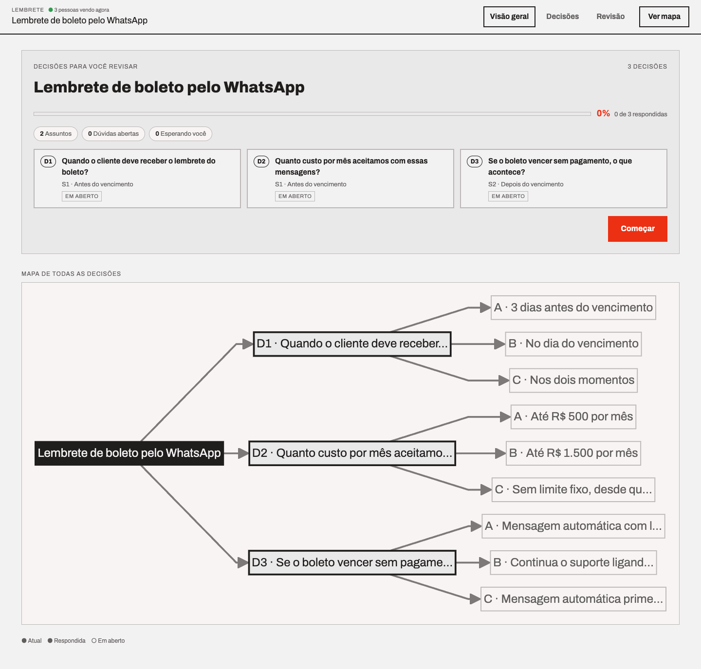
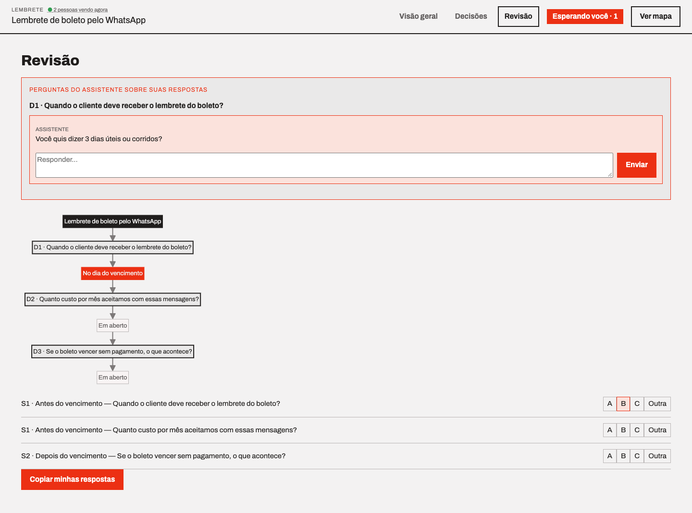
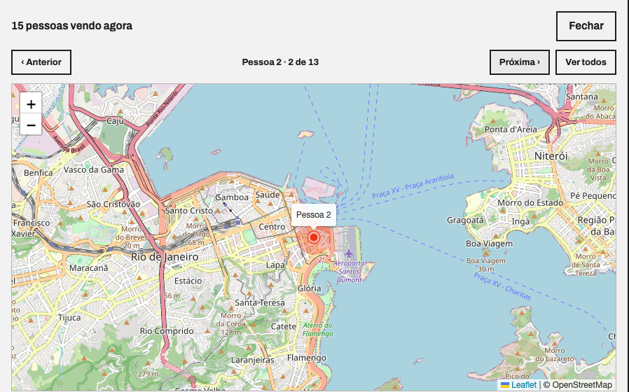
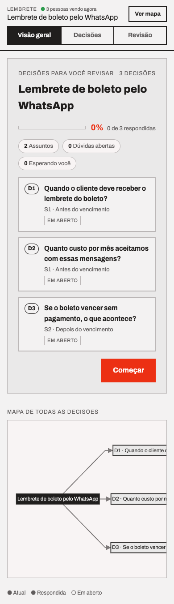
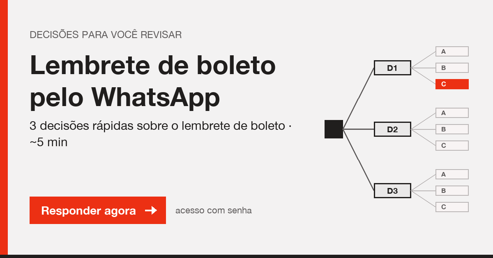

# decision-wizard

Turn a list of open decisions into a password-protected web wizard that a non-technical person can answer from their phone, asynchronously — one decision at a time, A/B/C or a free-text answer.

> UI text is in Brazilian Portuguese.

Built to close the loop between an AI coding agent (Claude Code) and a business stakeholder: the agent writes a JSON spec with the open questions, the wizard collects the answers, and the agent reads them back (and can ask follow-up questions that show up live on the page).

Zero external Python dependencies for the server (stdlib only). Exposed to the internet with a free `cloudflared` quick tunnel — no account, no deploy.



## Features

- **One decision per screen**, written in plain business language; technical detail collapsed behind "Detalhe técnico".
- **A/B/C options + "write my own answer"**; click a selected option again to clear it.
- **Breadcrumb** of the path taken, **decision map** (Mermaid) on the home and collapsed at the bottom of each decision, **progress** as "% · N de M respondidas".
- **Optional diagram per decision** (any self-contained HTML, e.g. an architecture diagram) embedded with a fullscreen mode.
- **Optional narrated audio** per decision via any HTTP TTS API (`generate_audio.py`), with HTTP Range support so it plays on Safari/iPhone.
- **Live follow-ups without refresh**: the agent asks a question about a free-text answer (`agent_followup.py ask`) and it appears on the open page within ~4 s, with a system notification and a `(1)` counter in the tab title.
- **"N pessoas vendo agora"** presence indicator (by IP); click it to open a map (Leaflet + OpenStreetMap) and step through viewers who allowed browser geolocation.
- **Evidence log**: every answer stores `ip`, country, user agent and (if allowed) coordinates server-side. Never sent back to the browser.
- **Link preview** (WhatsApp/Slack/Teams): per-spec 1200×630 Open Graph image with title and subtitle (`og_image.py`).
- **Security**: password never stored in clear (SHA-256 hash only), HMAC-signed session cookie, mutations only via POST, path-restricted static routes.

| Review with live follow-up | Presence map | Mobile | Link preview |
|---|---|---|---|
|  |  |  |  |

## Quick start

Requirements: `python3` (3.9+), `cloudflared` (`brew install cloudflared`). Optional: `Pillow` for the preview image, a TTS HTTP API for audio.

```bash
git clone https://github.com/daraujo85/decision-wizard.git
cd decision-wizard

WORK=/tmp/meu-wizard
mkdir -p $WORK/docs
python3 generate_wizard.py examples/lembrete-boleto/spec.json > $WORK/docs/revisao.html
python3 og_image.py examples/lembrete-boleto/spec.json $WORK revisao   # optional, needs Pillow

./start.sh $WORK
# prints URL=https://xxxx.trycloudflare.com and PASSWORD=<generated>
```

Send `<URL>/?doc=revisao` and the password (preferably through separate channels). Answers land in `$WORK/answers.json`.

## Spec format

```json
{
  "title": "Lembrete de boleto pelo WhatsApp",
  "sections": [{
    "id": "s1", "key": "S1", "title": "Antes do vencimento",
    "decisions": [{
      "tag": "D1",
      "question": "Quando o cliente deve receber o lembrete?",
      "plain": "Explanation in plain language.",
      "options": {"a": "3 dias antes", "b": "No dia", "c": "Nos dois momentos"},
      "optionPlain": {"c": "Trade-off explained simply."},
      "optionBadge": {"c": "Recomendado"},
      "tech": "Optional technical note (collapsed).",
      "diagram": "optional-diagram-name",
      "audio": true
    }]
  }]
}
```

Full field reference, the narration script, follow-up flow and every option are documented in [SKILL.md](SKILL.md) (it doubles as the Claude Code skill definition).

## Agent loop

```bash
# questions the user typed in the "Tenho uma dúvida" chat
python3 answer_questions.py list $WORK/questions.json revisao
python3 answer_questions.py answer $WORK/questions.json <qid> "resposta"

# agent asks the user about a free-text answer; shows up live on the page
python3 agent_followup.py ask $WORK/followups.json revisao s1-D1 "Você quis dizer dias úteis ou corridos?"
python3 agent_followup.py list $WORK/followups.json revisao --waiting-user
```

## Files

| File | Purpose |
|---|---|
| `generate_wizard.py` | spec JSON → wizard HTML |
| `server.py` | stdlib HTTP server: login, answers, follow-ups, presence, OG preview |
| `start.sh` | starts server + cloudflared tunnel, generates the password |
| `answers.js`, `wizard-core.js`, `wizard.css` | client (no build step) |
| `generate_audio.py` | one narrated mp3 per decision via TTS API |
| `og_image.py` | link-preview image (Pillow) |
| `theme_diagram.py` | applies the wizard palette to an archify diagram |
| `agent_followup.py`, `answer_questions.py` | agent-side CLIs |
| `test_*` | self-checks (`python3 test_load_robustness.py`, `bash test_server.sh`, `node test_wizard_core.js`, `python3 test_wizard_css.py`) |

## Privacy

The presence and evidence features record viewers' **IP address** and, only with browser permission, **geolocation**. Files: `presence.json`, and `evidence` inside `answers.json` / `questions.json` / `followups.json`. Tell your respondents, keep those files private and delete them when the review is over. Remove `sendPresence`/`askLocation` from `answers.js` if you don't want it.

## Use as a Claude Code skill

```bash
git clone https://github.com/daraujo85/decision-wizard.git ~/.claude/skills/decision-wizard
```

Claude Code picks up `SKILL.md` and uses the wizard when an analysis ends with open decisions.

## License

MIT

